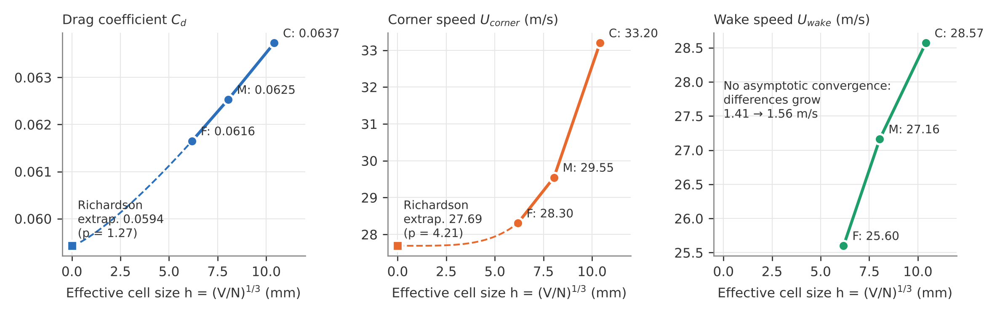
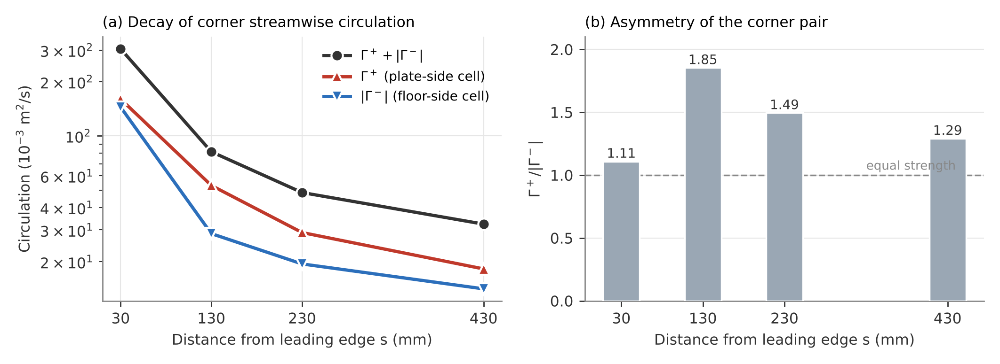

# Review of *BTP_Revised_Report.pdf* (final report, Nov 2026)

I re-checked every number in the report that can be recomputed from the report itself: Re, dynamic pressure, A_ref, inflation thickness, effective grid ratios, the full Celik GCI procedure, the flat-plate δ estimate, the circulation ratios and the C_f ratios. The script is `review/check_and_figures.py`. Most numbers are correct. The sections below list what needs fixing, what is missing, and text you can paste in.

Legend: **[MUST]** is an error an examiner will notice. **[SHOULD]** makes the report clearly stronger. **[MINOR]** is polish.

---

## A. Numbers verified as correct

| Item in report | Recomputed | Status |
|---|---|---|
| Re_L = U∞L/ν = 1.13 × 10⁶ | 1.134 × 10⁶ | ✔ |
| ½ρU∞² = 794 Pa | 793.8 Pa | ✔ |
| A_ref = 0.46 × 0.32 = 0.1472 m² | 0.1472 | ✔ |
| Inflation thickness ≈ 4.7 mm (0.01 mm, 25 layers, 1.2) | 4.72 mm | ✔ |
| h = (V/N)^(1/3) = 10.41 / 8.04 / 6.18 mm, r21 ≈ 1.300, r32 ≈ 1.295 | 1.301 / 1.295 (V ≈ 0.597 m³ on all three grids) | ✔ |
| C_d: p = 1.25, extrapolated 0.0594, GCI 4.6 % | p = 1.27, 0.0594, GCI 4.5 % | ✔ (difference comes from rounding r) |
| U_corner: p = 4.2, extrapolated 27.69, GCI 2.7 % | p = 4.21, 27.69, 2.70 % | ✔ arithmetic (but see B4) |
| Wake differences 1.407 → 1.562 m/s, 6.1 % | 1.407, 1.562, 6.10 % | ✔ |
| Drag change medium → fine 1.43 % | 1.427 % | ✔ |
| 0.37 s Re_s^(-1/5) ≈ 6 mm at s = 0.23 m | 6.02 mm | ✔ |
| √2·δ99 ≈ 36 mm | 36.5 mm | ✔ |
| Wall vorticity of order 10⁵ s⁻¹ | τ_w/μ ≈ 1.3 × 10⁵ s⁻¹ for C_f = 3 × 10⁻³ | ✔ |
| Signs: floor ω_x < 0, plate ω_y > 0 (flow in −z) | ω_x = ∂w/∂y < 0, ω_y = −∂w/∂x > 0 | ✔ |
| Pair signs (Γ⁺ beside plate, Γ⁻ above floor) vs vectors in Fig 3.5 | consistent with flow into the corner along the walls and out along the bisector | ✔ |
| Γ ratios 8.8, 10.3, 9.5; row sums in Table 3.2 | 8.81, 10.26, 9.45 | ✔ |
| C_f: 1.05/2.16 (≈ 50 % lower), 2.86/2.16 = +32 % | 0.49, 1.32 | ✔ |
| Cross-flow 3.5 m/s ≈ 10 % of U∞; 0.07–0.46 m/s ≈ 1 % | 9.7 %, 0.2–1.3 % | ✔ |

---

## B. Errors and inconsistencies to fix

### B1 [MUST] The ∇ symbol is missing in the PDF
The font used has no ∇ glyph, so the PDF shows an empty box "□" (the extracted text is a null character). This happens in:
* Chapter 1: "Vorticity is solenoidal, □·ω = 0"
* Section 3.4, equation: "u·□ω_z", "ν□²ω_z", "[□×(−□·**R**)]_z"
* Section 3.4, text: "□·ω = 0 implies …"

**Fix:** retype these with the Word equation editor (Cambria Math), or use the symbol ∇ (U+2207) in a font that has it. Write the equation as one display equation:

> **u**·∇ω_z = ω_x ∂w/∂x + ω_y ∂w/∂y + ω_z ∂w/∂z + ν∇²ω_z + [∇×(∇·**τ**_R)]_z,  where τ_R,ij = −⟨u′_i u′_j⟩. (3.1)

Also number the equation, because it is referred to in the text.

### B2 [MUST] Figure 3.4 and Table 3.2 disagree at z = 0
Figure 3.4 (z = 0 panel) shows **Γ⁺ = 29.3**. Table 3.2 gives **Γ⁺ = 29.0** and a total of 48.4. With 29.3 the total is **48.7**. Check the script output and make the two agree. The conclusions (ratios 8.8, 10.3 and 9.5) do not depend on this row.

### B3 [MUST] The 2 % stagnation-pressure overshoot is presented as if it were physical
Section 3.2 says the maximum pressure (837 Pa) is "a 2% overshoot relative to inlet total pressure at the sharp stagnation edge". In steady flow, static pressure cannot exceed the upstream total pressure (819 Pa). The overshoot is a numerical (discretisation) error at the sharp corner. Suggested replacement:

> "The node-averaged maximum pressure on the L is 837 Pa, 2 % above the inlet total pressure (819 Pa). Since the static pressure cannot physically exceed the upstream total pressure, this is a local discretisation error at the sharp stagnation edge and gives an indication of the local numerical error there."

### B4 [MUST] The corner-velocity GCI of 2.7 % is optimistic. State this explicitly.
The apparent order p = 4.2 is more than twice the formal order of the scheme (2). Because GCI ∝ 1/(r^p − 1), an inflated p makes the GCI small. Two facts show this:
* The actual medium → fine change in U_corner is **4.4 %**, which is larger than the 2.7 % "uncertainty".
* If p is limited to the formal order (p = 2), as is common practice (Roache; Celik et al. recommend caution when p > formal order), the result is **GCI ≈ 1.25 × 0.0439 / (1.30² − 1) ≈ 7.9 %**.

Also note that the extrapolated C_d (0.0594) is **3.7 % below** the fine-grid value. Suggested sentence for Section 3.1:

> "For the corner monitor the medium-to-fine change is 4.4 %. Because p = 4.2 exceeds the formal order, a more conservative estimate with p limited to 2 gives a GCI of about 8 %; the 2.7 % value should therefore be read as a lower bound. The extrapolated drag coefficient is 3.7 % below the fine-grid value."

Update the abstract and Conclusion 1 to match. For example: "…2.7 % (about 8 % if the order is limited to the formal value) for the corner velocity magnitude".

### B5 [SHOULD] The corner skin-friction drop is partly geometric
Within about 4 mm of a 90° corner, wall shear goes to zero simply because both walls are no-slip, even without any secondary flow. Section 3.6 attributes the 30–50 % reduction entirely to "low-momentum fluid collecting near the junction". Suggested wording:

> "Part of this reduction is geometric: the velocity gradient, and hence the wall shear, vanishes towards the 90° corner because both walls retard the flow. The secondary flow modifies the distribution around this, producing the 15–30 mm downwash band of increased C_f."

### B6 [SHOULD] Reconcile Section 3.3 with Sections 3.5 and 3.6 (momentum in the corner)
* Section 3.3: near-corner profiles are *fuller* (28.4 vs 26.0–26.7 m/s at d = 10 mm). Along the bisector, 99 % of U_e is reached at 27.3 mm. That point is only 27.3/√2 = **19.3 mm from each wall, which is less than δ99 = 25.6 mm**. So the corner region carries *more* momentum than either boundary layer alone, and the isovels bulge *into* the corner.
* Section 3.5 says "low-momentum fluid is swept along the walls into the corner and lifted along the bisector". Section 3.6 says "low-momentum fluid collecting near the junction".

Both statements can be true: the outward flow along the bisector only affects a thin region very close to the corner, and the high-momentum downwash 15–30 mm from the corner fills the rest. However, the report should say this explicitly so an examiner does not read it as a contradiction. Suggested sentence at the end of the first paragraph of Section 3.5:

> "The bisector outflow is weak (< 0.3 m/s) and confined to the region very close to the corner. The net effect over the corner region is dominated by the high-momentum downwash on either side, which is why the near-corner profiles in Figure 3.2 are fuller than the far profiles."

### B7 [SHOULD] Explain why U_e is 4 % above U∞, and state the domain-size limitations
U_e ≈ 37.4 m/s is reported but not explained. A simple blockage estimate accounts for it. The box cross-section is 0.60 × 0.50 = 0.30 m². The two blunt 10 mm edges block 2 × 0.32 × 0.01 = 0.0064 m² (2.1 %). Displacement thickness on the four wetted faces adds about 1.28 m × 6.2 mm ≈ 0.008 m² (2.6 %). Together these give about **4.8 %**, which matches the observed speed-up. Suggested sentence:

> "This speed-up is consistent with the combined blockage of the blunt edges (2.1 % of the domain cross-section) and the displacement thickness on the four wetted faces (≈ 2.6 %)."

Add these limitations to Section 2.1 or the Limitations paragraph:
* The top symmetry plane is only ≈ 80 mm above the free tip of the plate (Fig 2.1).
* The outlet is 0.77 m = **1.7 L** behind the trailing edge. The planned target was ≥ 3 L. This matters for the wake monitor at z = −0.35 m and may contribute to its non-convergence.

### B8 [MINOR] Other corrections
* **Symbol clash:** ω is used for both vorticity and the SST specific dissipation rate (Table 2.1 "SST k–ω", residual "(ω)" in Section 3.1). Add to the Notation table: "ω (in k–ω and residuals): specific dissipation rate, s⁻¹".
* **Notation table:** add ρ, μ, ν, p, k, I, μ_t/μ, q, R_ij (or τ_R), Re_s.
* **C_d definition (Section 2.2):** add "A_ref is the side area of one plate; the force includes pressure and viscous contributions on all eight faces of the L".
* **List of Figures / List of Tables** titles do not match the captions:
  * 2.1 "…refinement region and monitor points" vs caption "…BOI, cross-planes and monitor points"
  * Table 3.1 "Three-grid study using means over the last 200 iterations" vs caption "Final-200-iteration means…"
  * Use the same text in both places.
* **Fig 2.1(a):** the label "symmetry (top)" overlaps the domain frame. **Fig 2.1(b):** "LE z = +23" overlaps the z = +20 cross-plane line. Move these labels.
* **Fig 3.2(c):** the annotation says "27 mm" while the text says 27.3 mm. Use 27.3 in both.
* **Table 2.1** has no number above it in the body. Its caption is below it while the List of Tables calls it 2.1. This is fine, but check the template rule (tables are usually captioned above).
* **Section 3.1:** "Fine-grid C_d before iteration 178 is rescaled to the corrected reference values". Add one clause on why: the reference values were changed during the run.
* **Acknowledgements:** if you use AI again for this final round (including this review), update the AI-use disclosure so it matches the Declaration.

---

## C. Results and figures that are missing

### C1 [SHOULD, included] Grid-convergence figure
The grid study is the main verification result, but it is shown only as a table and monitor histories. Add **`review/figures/grid_convergence.png`** as the new Figure 3.2, placed right after Table 3.1. Renumber the later figures.

> **Figure 3.2:** Final-200-iteration means versus effective cell size for the three grids (C, M, F). Dashed lines and squares show the Richardson extrapolation h → 0 (Celik et al., 2008). C_d and U_corner converge monotonically, with C_d approaching its extrapolated value. U_wake shows growing differences and has no asymptotic estimate.

### C2 [SHOULD, included] Circulation decay and pair asymmetry
Table 3.2 contains a result the text describes only in words: the pair is **unequal at every station**. Add **`review/figures/circulation_decay.png`** after Table 3.2.

> **Figure 3.5:** (a) Signed and total circulation in the 60 × 60 mm corner window versus distance from the leading edge (log scale). (b) Ratio Γ⁺/|Γ⁻|. The plate-side (positive) cell is stronger at all four stations, by 11 % at s = 30 mm and by a factor of 1.85 at s = 130 mm. Most of the decay (a factor of 3.7 in total circulation) happens between s = 30 and 130 mm, that is, inside and just after the leading-edge separation region. Between s = 130 and 430 mm the total falls by only a further factor of 2.5.

Text to add after the existing circulation paragraph:

> "Figure 3.5 shows that most of the reduction occurs between s = 30 and 130 mm, where the leading-edge separation bubble reattaches (Section 3.2). The plate-side cell (Γ⁺) is stronger at every station (Γ⁺/|Γ⁻| = 1.11–1.85). This is consistent with the shorter floor separation bubble near the plate and with the asymmetric C_f enhancement in Section 3.6 (floor +32 %, plate +13 % at z = +0.10 m)."

### C3 [MUST] Section 3.2 (leading edge / horseshoe region) has no figure
Every statement in Section 3.2 (stagnation iso-surfaces, the strongest stagnation region at the inside corner, peak speed 1.24 U∞, separation and reattachment) is given without a figure, except a reference to Fig 3.6a. The professor's Step C asked specifically for the junction leading-edge region. Make one two-panel figure on the **fine grid** in CFD-Post:
* (a) C_p = (p − p∞)/(½ρU∞²) contour on the **front (LE) face of the L**, looking upstream. This shows the stagnation maximum at the inside corner.
* (b) Velocity vectors or surface streamlines on the plane **x = 0.02 m** (10 mm from the plate), zoomed to z = +0.23 … +0.10 m and y = 0 … 30 mm. This shows the separation bubble on the floor and its 40–50 mm reattachment near the plate. Optionally add a second plane far from the plate (x = 0.25 m) to show the 70–77 mm bubble.

Paste-ready caption:
> "Figure 3.x: Leading edge of the junction. (a) Pressure coefficient on the front face of the L; the maximum occurs at the inside corner. (b) In-plane velocity vectors on x = 0.02 m showing the separation bubble behind the blunt floor edge and reattachment at about 45 mm."

### C4 [MUST] Nothing is shown *behind* the plate, although the title is "flow behind a flat plate"
The only downstream quantity is the single wake monitor at z = −0.35 m. Nakayama and Rahai measured the wake behind the plate. Even with the wake monitor not grid-converged, add at least:
* An **isovel + cross-flow-vector panel at z = −0.30 and −0.40 m** in the same format as Fig 3.5. This shows how the corner wake recovers.
* A **corner-bisector velocity profile at z = −0.23 (TE), −0.30, −0.35 and −0.46 m (1 L behind)**, overlaid on one plot.

Report these as fine-grid, qualitative results and state that the wake monitor is not grid-converged. This also fulfils the professor's request to show how the corner region recovers downstream.

### C5 [SHOULD] Pressure versus viscous drag breakdown
Fluent's force report gives the pressure and viscous parts of C_d directly (Report → Forces → *direction (0,0,−1)*). A rough estimate suggests that most of C_d = 0.0617 is **pressure drag on the two blunt 10 mm edges**:
* Edge area / A_ref = 0.0064 / 0.1472 ≈ 0.043. With a blunt-edge C_D of about 1, the pressure part is ≈ 0.04–0.05, roughly 70–80 % of the total.
* Friction on four wetted faces at C_f ≈ 2.5 × 10⁻³ gives only ≈ 0.010.

If this is confirmed, C_d mainly measures the blunt-edge flow, not the junction. Add one sentence and the two numbers to Section 3.1. This also explains why C_d converges more smoothly than the corner and wake monitors.

### C6 [SHOULD] Show the verification evidence that the text cites
Section 3.1 quotes residual plateaus and y⁺ (0.77–0.93), but neither is shown. Add:
* the scaled-residual history of the fine grid (one small panel), and
* a y⁺ contour on the inside faces of the L, or a y⁺-versus-z line along the corner.

These two can go into an **Appendix A** if page count matters.

### C7 [OPTIONAL] Vortex lines at the leading-edge corner
The professor's ∇·ω = 0 argument is currently explained only in words, and the report says vortex-line analysis "was not performed". If there is time, add a CFD-Post figure: **vortex lines (streamlines of the vorticity vector)** seeded on a short line across the corner just inside the boundary layer at z = +0.22 m. Showing floor ω_x lines turning into plate ω_y lines near the corner would directly support the tilting interpretation. Once you have it, change "was not performed" in Section 3.4 to describe it.

### C8 [OPTIONAL] Grid sensitivity at the junction itself
A plot of the z = 0 near-corner C_f (or the bisector profile) on the three grids would show that the junction results, not only the integral C_d, are grid-insensitive.

---

## D. Suggested updated text for Conclusion 1 (to match B4 and C5)

> "1. The corrected L-junction RANS model satisfies y⁺ < 1 and global mass balance, with bounded final-iteration monitor variation. The fine-grid drag coefficient is C_d = 0.06165 (estimated discretisation GCI 4.6 %; extrapolated value 3.7 % lower), dominated by pressure drag on the blunt edges [confirm with C5]. The corner-speed GCI is 2.7 %, but this relies on an apparent order (4.2) above the formal order; limiting p to 2 gives about 8 %, comparable to the 4.4 % medium-to-fine change. These are discretisation estimates, not total uncertainties or experimental validation."

---

## E. Priority order if time is short
1. B1, B2, B3 and B4 (text and number fixes; about 30 min, no new simulation).
2. C1 and C2 (figures ready in `review/figures/`; paste and renumber).
3. C3 and C4 (one CFD-Post session on the existing fine-grid case/data; no new solve needed).
4. B5–B8, C5, C6.
5. C7 and C8 if time remains.
